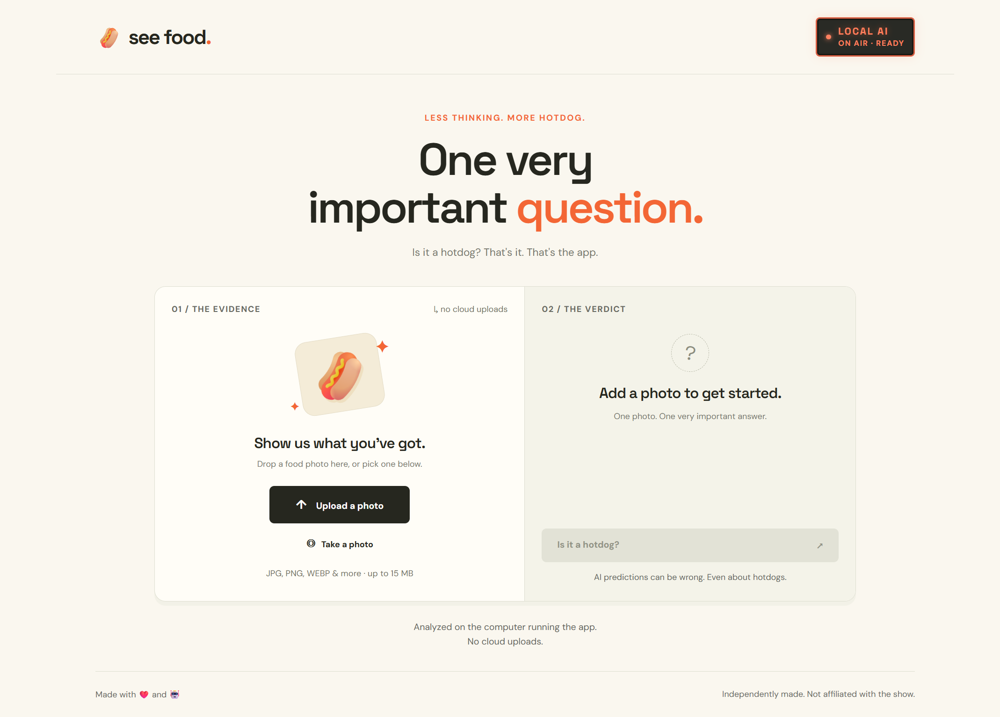

# See Food

"Hotdog" / "Not hotdog" classification with two selectable backends: **Browser WebGPU (experimental)** runs locally in your browser, while **LM Studio** uses [LiquidAI's d1-3B](https://huggingface.co/AtomicChat/d1-3B-GGUF) through the Python standard-library backend. The Python route requires Python 3.10+ and still runs directly from the root frontend files without a Node build. Static hosting uses a Vite production build.



## Browser WebGPU (experimental)

Choose **Browser WebGPU (experimental)** in the backend selector to load the model automatically. When this backend is selected on page load, loading starts automatically after the browser support check. Download progress, readiness, and errors remain visible; **Unload Model** stops loading or releases the model, and **Reload browser model** lets you retry afterward. The panel shows a single status message and **Technical details**; expand the details for the model name, download size, photo privacy, requirements, download sources, and caching caveats. Production builds (including GitHub Pages) default to this backend; they do not provide the Python API or an LM Studio proxy. Choose **LM Studio** when using the Python server described below.

- Requires a WebGPU-capable browser, a GPU adapter supporting `shader-f16` (fp16), and enough memory for the model and inference. Use **HTTPS or localhost**; ordinary HTTP LAN addresses are not secure contexts for WebGPU. Before automatically loading the model, the page checks the secure context, WebGPU API, adapter, FP16 feature, and creation of an FP16 device, then releases that test device. This preflight downloads no model weights and is repeated in the worker before loading. Passing it does not guarantee model operator compatibility or sufficient inference memory. There is no guaranteed CPU fallback.
- Loading downloads approximately **600 MB** for the q8 decision + fp16 vision stack of [`onnx-community/d1-omni-600M-ONNX`](https://huggingface.co/onnx-community/d1-omni-600M-ONNX/tree/4ebc1b97bf1477485371c79d1cf8d5e4e8eebfa0), pinned to revision `4ebc1b97bf1477485371c79d1cf8d5e4e8eebfa0`. GPU memory use can exceed download size. Model downloads begin automatically only when Browser WebGPU is selected and the browser support check passes.
- Photos stay in the browser in this mode. Model/configuration/tokenizer downloads contact **Hugging Face**. ONNX Runtime WASM glue and binaries are fetched on first use from **jsDelivr**, pinned to `onnxruntime-web@1.31.0-dev.20260914-8d85527a0`; direct-source browser modules may also use the JavaScript CDN. These services receive normal request metadata, not your photos.
- Browser caching is best effort: storage limits, eviction, private browsing, or cache clearing can require downloading again. Offline availability is **not guaranteed**.
- WebGPU support and performance vary by browser, driver, and device. The production build was exercised under a `/see-food/` project subpath in the integrated Chromium browser: the model loaded, the hotdog sample returned **Hotdog**, and the dachshund sample returned **Not hotdog**. This is a smoke test, not an accuracy benchmark or a guarantee across devices. A live GitHub Pages deployment still needs verification.

### Static build and development

Use Node.js **22.12+ (22.x)** or **24+** and npm. Build tooling is pinned to Vite **8.3.4** in the lockfile. The worker imports the standalone Transformers.js **4.3.1** browser module and matching ONNX Runtime Web version above from jsDelivr. Transformers.js supplies `AutoTokenizer`, `AutoImageProcessor`, and `RawImage`; inference uses ONNX Runtime WebGPU in a module worker.

```powershell
npm ci
npm run dev
```

Open the localhost URL printed by Vite. Both Vite development and production builds (including GitHub Pages) are static-only and offer only Browser WebGPU; the LM Studio option is removed and neither polls the Python API. Use the Python server for LM Studio mode, where both backend options remain available.

```powershell
npm run build
```

Deploy **only `dist`**. Vite uses relative asset URLs (`base: './'`) for project Pages paths, bundles the frontend's imported assets and ES module worker, and does not copy a public directory. Samples, README, Python sources, and unrelated root files are not copied. Runtime JavaScript and WASM are downloaded from pinned jsDelivr URLs, not shipped in `dist`. The worker uses one WASM thread, so custom cross-origin-isolation headers are not required. Root source files remain usable by the Python server without building.

The synchronized `package-lock.json` is included for reproducible `npm ci` installs. Commit it alongside dependency changes.

### GitHub Pages deployment

The workflow in `.github/workflows/pages.yml` runs on pushes to **main** and manually through **Actions → Deploy GitHub Pages → Run workflow**. It uses Node 24, runs `npm ci` and `npm run build`, uploads only `dist`, and deploys to the **github-pages** environment with Pages/OIDC permissions. Deployments are serialized.

A repository administrator must select **Settings → Pages → Build and deployment → Source: GitHub Actions**, ensure Actions/Pages are enabled, and satisfy any environment protection rules. This change does not modify repository settings. If the default branch is not `main`, update the workflow trigger. GitHub Pages supplies HTTPS but cannot run the Python server; LM Studio mode requires the separate local Python deployment.

### Model licensing

The browser model is © Liquid AI, Inc. under the **LFM Open License v1.0**, separate from the app's license. Review the [pinned model license](https://huggingface.co/onnx-community/d1-omni-600M-ONNX/blob/4ebc1b97bf1477485371c79d1cf8d5e4e8eebfa0/LICENSE), [upstream model](https://huggingface.co/LiquidAI/d1-omni-600M), and [Liquid AI licensing information](https://www.liquid.ai/lfm-license). Commercial use by organizations at or above **US$10 million annual revenue** requires a separate commercial license under its terms; do not assume unrestricted commercial use.

## 1. Prepare LM Studio

1. Load **d1-3b** with its vision adapter / multimodal projector. A text-only model cannot inspect photos.
2. Start the LM Studio server in the Developer tab. The default address is `http://localhost:1234`.
3. Keep LM Studio local-only. You do **not** need CORS or LM Studio's “Serve on Local Network” option: the Python app bridges phone requests to it.

The app uses `POST /v1/systemone` with an inline JPEG and a typed choice question. It accepts only `hotdog` or `not_hotdog`. See [LM Studio System One documentation](https://lmstudio.ai/docs/developer/jev-compat/systemone).

## 2. Run on this computer

From this folder in PowerShell:

```powershell
python .\src\server.py
```

Open `http://localhost:8000`.

Opening the HTML file directly is unsupported. A static-only server can run the built Browser WebGPU app, but cannot run the LM Studio backend. For the following Python instructions, select **LM Studio**. Upload a photo and select **Is it a hotdog?**. The result replaces the classify action with **Try another photo**; errors offer **Retry**. The crossed-out hotdog icon accompanies a negative verdict - "Not hotdog". On touch-first devices, **Take a photo** is the primary photo action; desktop prioritizes upload. The radio-style **Local AI** sign lights up **ON AIR · READY** when LM Studio reports the configured decision model loaded with vision support. It dims to **OFF AIR** when unavailable/unloaded and shows **ANALYZING** while this app is running inference. It checks `/api/v1/models` through the backend on page load and every 10 seconds while the page is visible; no inference is run and no model is auto-loaded by these checks. Returning to the tab refreshes status. Upload, camera, drag-and-drop, photo replacement, and analysis are blocked until the sign reports ready. A failed or pending check displays an explanatory notice, and controls re-enable automatically on recovery. If readiness is lost after choosing a photo, the preview is retained but cannot be analyzed until readiness returns. In-progress analysis is allowed to finish. This is a metadata readiness check, not a guarantee that inference will succeed or that LM Studio is idle for other applications.

Stop with Ctrl+C.

If your model identifier or LM Studio port differs:

```powershell
python .\src\server.py --model d1-3b --lm-url http://localhost:1234
```

If LM Studio authentication is enabled, set `LM_STUDIO_API_KEY` in the server's environment before starting it. Never put the key in browser code or commit it. `LM_STUDIO_URL` and `LM_STUDIO_MODEL` can also supply defaults. Only loopback HTTP LM Studio addresses are accepted.

## 3. Use your phone over Wi-Fi

```powershell
python .\src\server.py --host 0.0.0.0
```

- Use a trusted **private** Wi-Fi network; connect both devices to the same network.
- Open the printed `http://<computer-IP>:8000` phone address on your phone, not `localhost`. If multiple addresses appear, use the Wi-Fi adapter's IPv4 address shown by `ipconfig`.
- If Windows Firewall prompts, allow Python on **Private networks only**, never Public. Do not disable the firewall. If needed, allow inbound TCP port 8000 only on the Private profile.
- Guest Wi-Fi/client isolation or a VPN may block phone-to-computer traffic.
- Do not forward this port on your router. This lightweight server has no user authentication or HTTPS and is intended only for a trusted home LAN, not internet hosting. Wi-Fi image requests use unencrypted HTTP.
- **Take a photo** requests the rear camera through the mobile file picker. Browser/device support varies; the photo library fallback still works. This does not use `getUserMedia`, which requires HTTPS away from localhost.

## Images and privacy

Images up to 15 MB are decoded in the browser, resized to a maximum 1280-pixel edge, flattened onto white, and re-encoded as JPEG. This supports browser-decodable formats and strips original metadata from the transmitted image. Unsupported HEIC files should be converted to JPEG first. Animated images are classified from one rendered frame.

In **LM Studio** mode, the prepared photo travels to the Python server on your computer, then to LM Studio on that same computer. In **Browser WebGPU** mode, the photo stays in the browser. The app does not persist images, filenames, or model responses; the Python server restricts static serving to its frontend allowlist. Check LM Studio's own logging/storage settings separately. Google Fonts makes optional typography requests, but receives no photos; system fonts work offline.

The model can make mistakes, especially for unusual foods or ambiguous photos...like a person wearing a hotdog costume. The Python server allows one inference at a time across connected clients; additional requests receive a busy error. Browser WebGPU runs one inference at a time per page. Photo changes and backend switching are disabled during analysis. **Unload Model** terminates browser loading or inference; reload the model to retry. Requests time out after approximately two minutes, but inference already running inside LM Studio may finish before the next request can run.

## Troubleshooting

- **Stuck on CHECKING; backend selector does not respond:** after updating the app, restart any already-running Python server, then refresh the page. An old process retains its original static-file allowlist even while serving newly edited HTML/JavaScript, so browser modules can return 404. The app now loads the capability module dynamically so this failure shows a restart/redeploy message instead of preventing all UI initialization.
- **WebGPU “No cached or pending pipeline for deferred dispatch: Clip”:** this is an ONNX Runtime pipeline-cache failure in vision positional embedding clamping, not a Python-versus-Vite hosting requirement. The worker routes only the three positional `Clip` nodes to local CPU execution; the neural networks remain on WebGPU and no photo is uploaded. Refresh the page to pick up the updated worker, then load the browser model again. Cached model weights can be reused. If it persists, capture the browser version, GPU/driver, and full error; GPU/browser compatibility still varies.
- **Cannot reach LM Studio:** start its server; verify the address and model.
- **LM Studio rejected the image request:** check the LM Studio logs, D1 selection, and loaded vision adapter; update LM Studio if `/v1/systemone` is unavailable.
- **Authentication error:** configure `LM_STUDIO_API_KEY` on the Python server if you have it enabled in LM Studio.
- **Timeout:** wait for model loading, try a smaller image, or check available memory in LM Studio.
- **Phone cannot connect:** check the Wi-Fi IPv4 address, Private firewall rule, and network isolation. Keep the computer awake.

## Tests

JavaScript tests:

```powershell
npm test
```

Python backend and static-asset regression tests:

```powershell
python -m unittest discover -s tests -v
```

Tests use a mocked model for request validation, strict result parsing, offline errors, cross-origin/host checks, static-file restrictions, and concurrency. Real classification additionally requires the running LM Studio model.

Original interface and assets; not affiliated with Silicon Valley or its creators.
